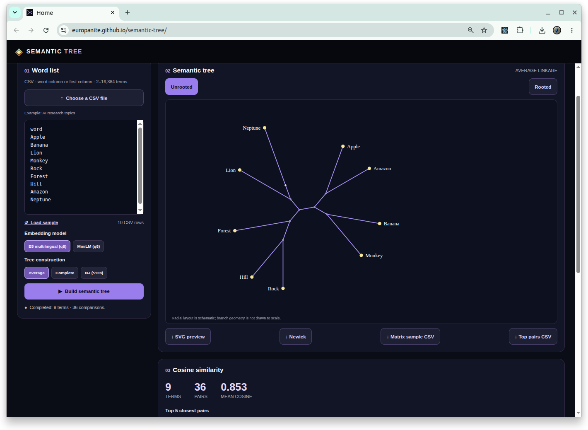

# [Semantic Tree](https://github.com/europanite/semantic-tree)

[](LICENSE)

[](https://github.com/europanite/semantic-tree/actions/workflows/ci.yml)
[](https://github.com/europanite/semantic-tree/actions/workflows/docker.yml)
[](https://github.com/europanite/semantic-tree/actions/workflows/pages.yml)



## PlayGround

[▶ Open the app](https://europanite.github.io/semantic-tree/)

**Semantic Tree inside the Browser**

 Import a CSV of words or phrases, compute multilingual sentence embeddings and every pair's cosine similarity, and build scalable **Average/Complete Linkage** semantic dendrograms, with optional Neighbor Joining on small inputs.

## Features

- **Input:** 2–16,384 distinct words/phrases in UTF-8 or Shift_JIS CSV, pasted or uploaded (up to 8 MiB). Handles headers, quoted CSV and duplicate removal.
- **Embedding:** Default `Xenova/multilingual-e5-small` (`query: ` prefix applied consistently); optional multilingual MiniLM. Both use WASM ONNX inference with `q8` quantization entirely inside a browser Web Worker; batches of 8 terms.
- **Distance:** Every pair is evaluated as `1 − cosine similarity`, using a compact, symmetric Float32 triangular matrix. No backend or inference API.
- **Clustering:** Exact **Average Linkage (UPGMA)** by default, or **Complete Linkage**, with the nearest-neighbor-chain algorithm. **Neighbor Joining** is available for up to 128 terms only. Average/Complete output a genuinely rooted dendrogram; the unrooted toggle is a *radial view of that same hierarchy*, not an independent NJ tree.
- **Visualization:** Full topology is retained; for more than 128 terms only a condensed preview (up to 128 visible groups) is rendered to prevent UI lockups.
- **Export:** Full-resolution tree in Newick containing **all** terms, SVG of the rendered *preview*, cosine statistics/top 30 pairs CSV, and a matrix CSV preview of the **first 24 terms** (the full 8K×8K matrix is intentionally not rendered or exported).
- **Deployment:** Static Expo Web build on GitHub Pages, existing Docker Compose test workflow, and standalone Node regression tests.

> A semantic dendrogram expresses embedding-model proximity, **not biological descent or a validated conceptual ontology**. Root position for Average/Complete is the agglomerative hierarchy; NJ alone uses optional midpoint rooting. The radial drawing is schematic, not a proportional distance plot. For large jobs, allow minutes of CPU inference and substantial RAM.

### Scale and memory

| Terms | Pairs (exact) | Packed distance memory |
| ---: | ---: | ---: |
| 8,192 | 33,550,336 | 128 MiB |
| 16,384 | 134,209,536 | 512 MiB |

Distance storage is O(n²), with O(n²) nearest-neighbor-chain linkage time. In addition to this memory, browsers require model/runtime memory and embeddings (384 float values per term). 16K words may exhaust memory on low-RAM machines; the hard cap is 16,384 in this version. Model embedding inference (8 words per batch) is typically a larger time cost than linkage at 8K; time depends heavily on hardware. If you need larger lists or lower memory, an approximate nearest-neighbor/sparse clustering algorithm would be a separate mode, not an exact Average Linkage implementation.

## Paper-level research map (new: local backend)

Switch to **Paper tree (local backend)** to organize actual research publications instead of isolated terms. The original **Word tree (browser only)** is unchanged and still deploys on GitHub Pages. The paper workspace needs a local Python API; a static GitHub Pages build **cannot host that backend**.

### Capabilities

- **Broad OpenAlex field survey:** A 29-topic preset (18 original broad headings plus 11 new ones) samples general AI security, robustness, vision, safety, and interpretability research **without searching for named papers or fine-grained target attacks**. There is no application-level count cap on headings or papers. Each field may be sampled across three rankings (relevance, citation count, latest date); then one-hop backward-citation expansion adds papers from the collected works' reference graph. The same work is deduplicated across searches. Default: 29 × 100 field slots + 600 citation slots (3,500 requested slots before deduplication); larger limits can be entered as numbers. No bundled bibliography records are force-inserted. This is coverage-oriented sampling, not a complete census.
- **Bibliography CSV:** Import `id`, `title`, optional `doi`, `year`, `group`/`groups`, `url`. The CSV's `abstract` field, if any, is **ignored**. Paper mode retrieves original abstracts from arXiv/OpenAlex at import time; papers without supported IDs/DOIs or source abstracts are omitted with reasons. Semicolons separate multiple group labels.
- **Paper embeddings:** Title plus abstract. Local CPU **MiniLM** (default), **TF-IDF** baseline (no neural model download), or optional **SPECTER2** scientific-paper proximity adapter. The model runs on your machine, *not* a hosted inference API.
- **Hierarchy:** Cosine distance + SciPy Average or Complete Linkage. The dendrogram leaf is a paper (not a word). Automatically extracted TF-IDF terms name clusters; titles and abstracts remain available in the detail panel.
- **Cross-field exploration:** Papers belonging to multiple search groups, nearest paper pairs from different groups, and known in-corpus citation links. Citation links are recorded but do not directly determine the embedding tree.
- **Exports:** Complete Newick paper tree, SVG *preview* (at most 128 visible groups), and JSON with full paper metadata, topic clusters, cross-field scores and in-corpus citation edges.

### Run both applications (Docker Compose)

From the repository root (`~/semantic-tree` on the example machine):

```bash
cd ~/semantic-tree
# Build and start the browser UI and local paper API.
docker compose up -d --build
# Inspect running services.
docker compose ps
# Verify the paper API.
curl -fsS http://127.0.0.1:8000/api/health
# Open the browser UI at http://localhost:8081
```

To inspect service logs and shut the application down:

```bash
cd ~/semantic-tree
docker compose logs --tail=100 -f paper_backend
# Press Ctrl+C to stop following logs (the containers keep running).
docker compose down
```

Test containers, also from the repository root:

```bash
docker compose -f docker-compose.test.yml run --rm --build backend_test
docker compose -f docker-compose.test.yml run --rm --build frontend_test
```

The paper API listens only on `127.0.0.1:8000` (host side); the Expo front-end is on port `8081`. The initial MiniLM run downloads Hugging Face model weights to the persistent Docker `paper_models` volume and may take extra time. If OpenAlex requires an API key or a higher quota, set `OPENALEX_API_KEY` in a local environment variable before running Compose. arXiv/OpenAlex abstract retrieval requires network access. Analysis of previously resolved paper records can be offline after the model is cached, or immediately with TF-IDF.

To install the **optional SPECTER2 proximity adapter** into the paper container (much larger model and dependency footprint):

```bash
docker compose -f docker-compose.yml -f docker-compose.specter2.yml up -d --build
```

Select `SPECTER2 (optional)` in the interface. This loads `allenai/specter2_base` with the `allenai/specter2` proximity adapter. First inference downloads model weights. Adapter and Transformers version compatibility can vary; the SPECTER2 path has not been run against downloaded weights in this release.

### Systematic broad paper discovery

The **29-topic preset** keeps the original 18 headings and adds the 11 previously
missing search topics from the following 12-topic research vocabulary. The first
entry was already present, so it is not duplicated. These are **subject search
phrases**, not named-paper queries or a guarantee of exact literature coverage.

| Research topic | Group used in search | Purpose |
| --- | --- | --- |
| Adversarial Machine Learning | AI Security | General adversarial-learning landscape (already in the preset) |
| Adversarial Examples | AI Security | Inputs that induce model failures |
| Adversarial Robustness | AI Security | Attack resilience and defenses |
| Physical-World Adversarial Attacks | AI Security | Environmental and physical deployment conditions |
| Robust Computer Vision | AI Security | Reliability of visual recognition |
| Localized Perturbations | AI Security | Spatially constrained input changes |
| Universal Adversarial Perturbations | AI Security | Cross-image transfer of perturbations |
| Transformation Robustness | AI Security | Robustness under scale, rotation and viewpoint changes |
| Visual Saliency and Attention | XAI | Which inputs the model responds to |
| Gradient-Based Interpretability | XAI | Gradient evidence and attribution |
| Generative Adversarial Networks | AI Security | Generation-based research neighborhood (may include broader GAN work) |
| Certified Robustness | AI Security | Formal or certified protection guarantees |

The search group labels denote **which query retrieved a paper**, not a validated
subject classification. In particular, the GAN query may retrieve publications
outside adversarial security; review their abstracts and clusters before drawing
conclusions. The existing 59-paper bibliography is **never inserted into search
results**. Papers are discovered from OpenAlex and one-hop references, not by
looking for a particular paper title or author.

1. In **Paper tree**, choose **Broad field survey (29 topics)** and **Search OpenAlex**. The preset does not name individual publications, authors or specific attack implementations. Each heading samples three OpenAlex rankings: relevance, citation count and most recent publication. Those rankings diversify coverage beyond the first result page. These sort and OR-filter facilities are documented in the OpenAlex API.
2. The server follows **one hop of references** from the discovered papers, ranking references by how many independent papers cite them. A reference is retrieved only if OpenAlex provides its original abstract. Results record counts for the two discovery stages, and the tree is built from the combined unique works.
3. This method *may* recover important papers not returned by the initial general queries, but does **not** guarantee that any particular publication or all of a field are included. For scholarly recall evaluation, inspect the exported corpus **after collection**; do not alter the collection process to force a chosen answer.

Do not enable the independent **Fetch 59 real-paper abstracts** button as part of this survey: it is a separate demonstration dataset and is not merged into search results. All downloads contact the OpenAlex public metadata service (not a remote model API), and local embedding/clustering is unchanged. There is no application-level paper count limit. Provider request quotas and local compute/memory remain practical limits. Citation-group memberships indicate the field of the citing corpus, **not a manually verified classification** of the cited publication.

### Troubleshooting OpenAlex search errors

The broad survey makes many OpenAlex metadata requests. OpenAlex permits basic
anonymous requests, but its free API key raises the daily budget and supports
cursor pagination. For a 29-topic survey, obtain a **free** API key from
[OpenAlex](https://openalex.org/) (account → Settings → API key), then configure:

```bash
cd ~/semantic-tree
read -rsp 'OpenAlex API key: ' OPENALEX_API_KEY
echo
export OPENALEX_API_KEY
docker compose up -d --build --force-recreate paper_backend
```

Use your **actual** key, keep it out of Git, and confirm the key is activated. The command above keeps the key out of the shell command history; it applies to the current terminal session.
Without a key, basic searching can still work within OpenAlex's limits. API
requests do not invoke remote model inference; embeddings run locally.

The search error now reports the OpenAlex HTTP status, phase and provider message:

- **400:** Invalid filter/query/sort; inspect the displayed message.
- **401/403:** Invalid or unactivated API key; check the OpenAlex account.
- **429:** Per-second throttling or daily credits; short delays are retried,
  while daily exhaustion is reported without pointless retries. Configure a key
  or wait for the reset. No paper cap or automatic query reduction is imposed.
- **5xx / network error:** Provider or container connectivity failure; inspect
  `docker compose logs --tail=100 paper_backend` and retry.

Check the backend independently:

```bash
curl -fsS http://localhost:8000/api/health
# Show the actual OpenAlex response status from the backend container:
docker compose exec paper_backend python -c "import httpx; r=httpx.get('https://api.openalex.org/works',params={'search':'adversarial machine learning','per_page':1},timeout=20); print(r.status_code, r.text[:300])"
```

### Source-verified abstracts for the 59-paper bibliography

Select **Fetch 59 real-paper abstracts**. The bundled [`examples/papers-real.csv`](examples/papers-real.csv) contains real-publication **bibliographic references only**; it has no `abstract` or paraphrase field. At runtime, the backend retrieves the original text from arXiv Atom's `<summary>` for an arXiv ID, or from OpenAlex's reconstructed `abstract_inverted_index` for a DOI, preserving the returned words (normalizing whitespace only).

- Incoming CSV `abstract` values are **ignored**. CSV import resolves source abstracts by arXiv ID or DOI instead.
- If an abstract cannot be retrieved, its identifier and title don't match the provider, or a provider is unavailable, the entry is **excluded** and its reason is returned; there is **no fabricated fallback**.
- Real abstract counts may be **less than 59**. Use the displayed included/excluded totals and the listed omission reasons to assess coverage. Requires network access; OpenAlex may require `OPENALEX_API_KEY` depending on quota.
- OpenAlex search also skips records without an original indexed abstract. Analyses with missing `abstract`/`abstract_source` are rejected.

`GET /api/papers/curated` resolves the 59-item bibliography; `POST /api/papers/resolve` resolves custom CSV metadata; `POST /api/papers/analyze` builds the tree. `http://localhost:8000/docs` documents these API routes.

**Important correction:** Earlier generated outputs (`ai_security_xai_real_papers_tree.svg`, `.nwk`, `.json`) were based on editorial paraphrases, **not paper abstracts**. Discard those outputs for research analysis; rebuild after source retrieval.

### Backend tests

```bash
docker compose -f docker-compose.test.yml run --rm --build backend_test
# Existing frontend unit tests remain independent:
docker compose -f docker-compose.test.yml run --rm --build frontend_test
```

Tests include metadata reconstruction, deduplication, abstract parsing, cross-field candidates, citation edges, API validation and mocked provider tests proving editorial CSV text is never used as an abstract. They do not download external models or contact OpenAlex.

**Interpretation:** The dendrogram is an exploratory map of *textual/semantic proximity*, not a validated conceptual ontology or a reconstruction of how research evolved. Abstracts may be missing, keyword topic labels may be imprecise, and high cross-field similarity is not proof of novelty or an unstudied research gap. Verify candidate relationships using the original papers. Initial clustering has no fixed paper limit but scales quadratically in pairwise memory; large corpora may exhaust available RAM. OpenAlex basic paging stops at 10,000 results per query/ranking; provide OPENALEX_API_KEY to enable cursor paging for deeper searches. Provider quotas and rate limits still apply.

### Model / data attribution

- OpenAlex API: https://docs.openalex.org/ (scholarly metadata)
- MiniLM model: https://huggingface.co/sentence-transformers/all-MiniLM-L6-v2
- SPECTER2: https://github.com/allenai/SPECTER2 (optional scientific-paper embedding)

## Quick start with Docker Compose

Prerequisite: Docker with Compose.

```bash
docker compose up -d --build
```

Open **http://localhost:8081** and select a `.csv` file or try the prefilled example.

### Tests

```bash
docker compose -f docker-compose.test.yml up --build --abort-on-container-exit --exit-code-from frontend_test
```

The test container runs TypeScript checking and Jest unit tests; the CI workflow also smoke-tests `expo export -p web`. Additional dependency-free algorithm tests and an 8,192-term synthetic benchmark:

```bash
node --experimental-default-type=module --test tests/large-clustering.test.mjs
node --experimental-default-type=module tests/benchmark-8192.mjs
```

The 8,192-term benchmark uses **synthetic 2-dimensional normalized vectors** to check allocation, exact clustering, condensed preview, and full Newick output; it does not benchmark E5 inference or real 384-dimensional cosine computation.

### Local development without Docker

```bash
cd frontend/app
npm install
npm run start
```

To create a production static build:

```bash
cd frontend/app
npm run build:web
```

The static output is `frontend/app/dist`.

## CSV format

The application selects a column named `word`, `words`, `term`, `text`, `label`, etc., if present; otherwise it treats the first column as the list and assumes there is no header. Use one term per row.

```csv
word
Artificial intelligence
Machine learning
Deep learning
Explainable AI
Adversarial examples
Evolutionary computation
Natural evolution strategies
```

## Design notes and limitations

- App is **web-only** for CSV browser file selection and Web Workers. React Native/Expo structure is retained, but native mobile builds are not a supported output.
- Embeddings are computed in batches of 8, up to 16,384 terms; the first model download may be large and needs substantial browser memory.
- Numeric cosine comparisons use the provided model, not a domain-specialized linguistic or biological taxonomy.
- The Average/Complete output is a **rooted dendrogram**. Its "Unrooted" tab removes root emphasis for a radial layout but is not a separately inferred tree; NJ is the only method creating an unrooted tree.
- If model downloads are blocked by ad blockers, a firewall, or an offline browser, analysis cannot run.


## License

- Apache License 2.0
